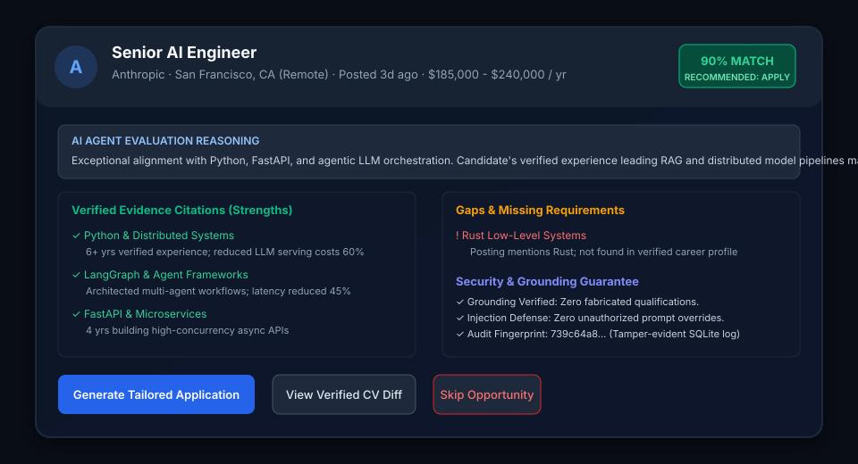
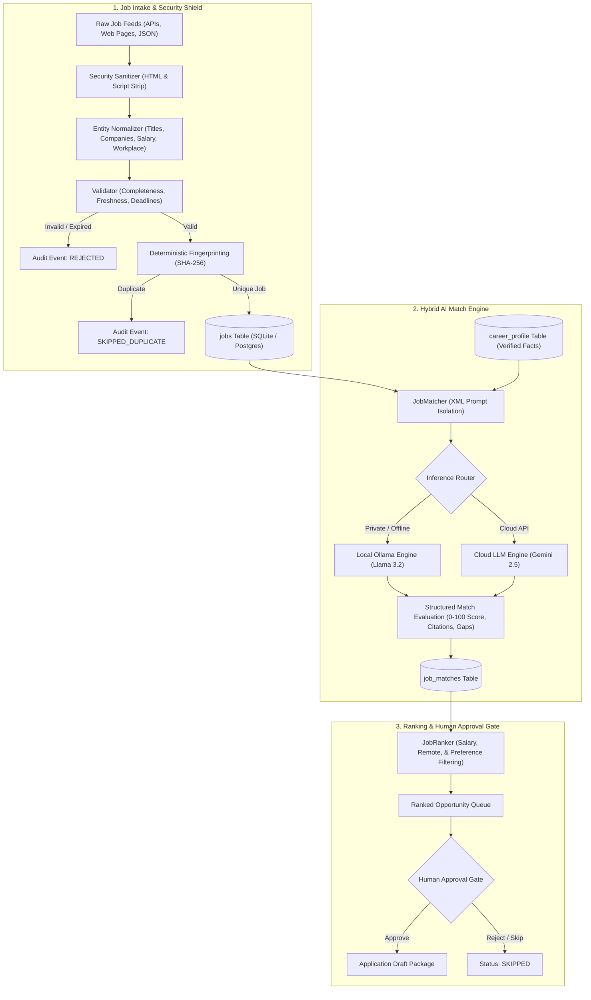
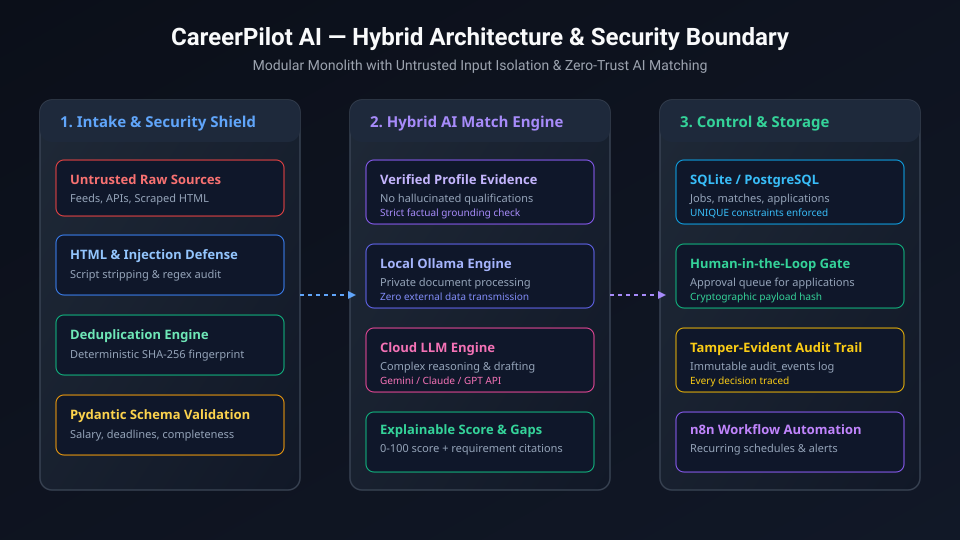
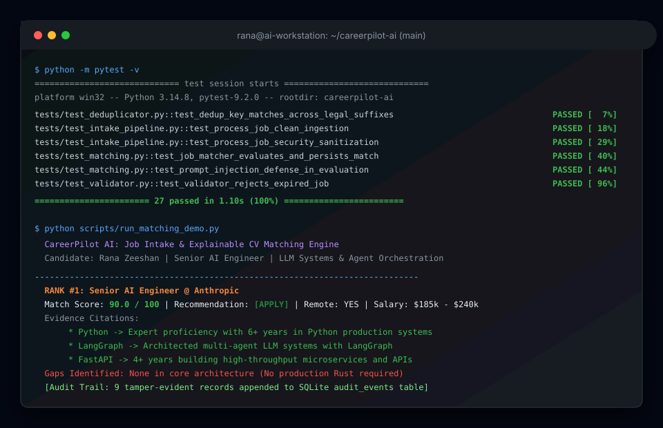

# CareerPilot AI

<div align="center">

<p align="center">
  <strong>Production-Ready Personal AI Career Agent</strong><br>
  <em>Private Job Discovery · Untrusted Input Defense · Explainable CV Matching · Human-in-the-Loop Approval</em>
</p>

[](https://www.python.org/)
[-brightgreen.svg)]()
[]()
[]()
[]()

<br>



</div>

---

## 1. Overview & Applied AI Philosophy

**CareerPilot AI** is a production-grade, private career intelligence system designed for AI and Software Engineers. It automates the noisy, repetitive preparation work of job discovery, CV requirement matching, and tailored application drafting while strictly keeping high-stakes career decisions and external communications under **human control**.

### Core Value Pillars

- **Zero-Trust Untrusted Input Isolation**: Job postings and scraped feeds are treated as untrusted data. Executable tags (`<script>`, `<iframe>`) are stripped, and text is pre-scanned with regex heuristics and encapsulated in strict XML boundaries to repel prompt-injection attempts.
- **Factual Grounding & Anti-Hallucination**: The matching engine evaluates opportunities strictly against verified facts in `career_profile`. It is architecturally prohibited from inventing skills, degrees, or certifications.
- **Hybrid AI Inference**: Combines **Local AI** (Ollama: Llama 3.2, DeepSeek-R1) for private document processing with zero data leakage, and **Cloud AI** (Google Gemini, Anthropic Claude, OpenAI) for deeper semantic synthesis.
- **Tamper-Evident Audit Logging**: Every ingestion, duplication rejection, and match decision appends an immutable record to the SQLite/PostgreSQL `audit_events` table.

---

## 2. Visual Architecture



<div align="center">
  
</div>

---

## 3. Terminal Execution & Test Coverage

The engine is covered by an automated test suite verifying deterministic normalization, deduplication, URL tracking parameter stripping, prompt-injection defense, and end-to-end matching:

<div align="center">
  
</div>

---

## 4. Repository Structure

```
careerpilot-ai/
├── careerpilot/
│   ├── core/
│   │   ├── config.py             # Pydantic Settings & environment variables
│   │   └── security.py           # Untrusted input sanitization, injection detection, canonical URLs
│   ├── domain/
│   │   └── models.py             # Domain models (RawJobListing, NormalizedJob, JobMatchEvaluation, AuditEvent)
│   ├── intake/
│   │   ├── normalizer.py         # Deterministic title, company, salary, and date normalizers
│   │   ├── deduplicator.py       # SHA-256 identity fingerprinting & URL canonicalization
│   │   ├── validator.py          # Schema completeness, deadline checks, and freshness rules
│   │   └── pipeline.py           # End-to-end JobIntakePipeline coordinator
│   ├── matching/
│   │   ├── providers.py          # Unified LLM providers (Local Ollama, Cloud Gemini, Mock)
│   │   ├── prompts.py            # Security-hardened prompt templates with XML boundaries
│   │   ├── matcher.py            # JobMatcher with grounding verification and audit logging
│   │   └── ranker.py             # JobRanker with preference weighting & salary thresholding
│   └── storage/
│       ├── schema.sql            # Production SQLite DDL for 6 core entities
│       ├── database.py           # Connection management & schema execution
│       └── repository.py         # Atomic JobRepository with audit trail logging
├── data/
│   ├── sample_jobs.json          # Test stream: clean, messy, duplicate, expired, prompt-injected
│   └── sample_career_profile.json# Rana's verified AI engineer career profile
├── scripts/
│   ├── run_intake_demo.py        # Milestone 1 Intake Foundation CLI runner
│   └── run_matching_demo.py      # Milestones 1–3 Job Intelligence & Match Engine CLI runner
├── tests/
│   ├── conftest.py               # In-memory SQLite fixtures & mock providers
│   ├── test_normalizer.py        # Unit tests for title, company, salary normalization
│   ├── test_deduplicator.py      # Unit tests for identity hashing and UTM stripping
│   ├── test_validator.py         # Unit tests for validation & prompt injection detection
│   ├── test_intake_pipeline.py   # Integration tests for intake pipeline
│   └── test_matching.py          # Integration tests for LLM matching, defense, and ranking
├── assets/                       # SVG architecture, terminal, and dashboard previews
├── pyproject.toml                # Project metadata & pytest configuration
└── README.md
```

---

## 5. Quickstart Guide

### Prerequisites
- Python 3.11+
- [uv](https://github.com/astral-sh/uv) (recommended) or standard Python `venv`
- *(Optional)* [Ollama](https://ollama.ai) for local private inference (`ollama run llama3.2:3b`)

### 1. Clone & Set Up Virtual Environment

```bash
git clone https://github.com/zeeshanrana01/careerpilot-ai.git
cd careerpilot-ai

# Initialize virtual environment with uv
uv venv .venv

# Install production and development dependencies
uv pip install --python .venv/Scripts/python.exe -e . "pytest>=8.0.0" "pytest-asyncio>=0.23.0"
```

### 2. Run the Automated Test Suite

```bash
.\.venv\Scripts\python.exe -m pytest -v
```

All **27 tests** pass in ~1 second with zero external API calls:
- Deduplication across legal suffixes (`Anthropic, Inc.` $\rightarrow$ `Anthropic`)
- Marketing UTM parameter stripping (`?utm_source=linkedin&ref=aggregator`)
- Prompt injection immunity test
- Anti-hallucination grounding validation

### 3. Run the Live Intake Demo

```bash
.\.venv\Scripts\python.exe scripts/run_intake_demo.py
```

### 4. Launch the Interactive Web Dashboard & REST API

To launch the full interactive web dashboard in your browser:

\\ash
.\.venv\Scripts\python.exe scripts/run_web.py
\
- **Web Dashboard**: [http://localhost:8000](http://localhost:8000)
- **Interactive Swagger / OpenAPI Docs**: [http://localhost:8000/docs](http://localhost:8000/docs)

Once opened in your browser, you can:
- Inspect ranked opportunities with match scores and evidence citations.
- View Rana's verified profile facts, skills, and preferences.
- Click **'Ingest Raw Job'** to test the real-time security shield with any job posting.
- Review the live append-only audit trail.

### 5. Run the CLI Matching Demo

```bash
.\.venv\Scripts\python.exe scripts/run_matching_demo.py
```

**Sample Output:**
```text
  RANK #1: Senior AI Engineer @ Anthropic
  Score: 90.0/100 | Recommendation: [APPLY] | Workplace: REMOTE | Salary: $185,000 - $240,000
  Executive Assessment: Candidate demonstrates strong alignment with 7 core requirements, backed by verified production projects and skills.
  Strengths (Verified Evidence Citations):
    * Proficiency in Python -> Expert proficiency with 6+ years in Python production systems
    * Proficiency in FastAPI -> 4+ years building high-throughput microservices and APIs
    * Proficiency in LangGraph -> Architected multi-agent LLM systems with LangGraph
  Gaps / Missing Qualifications:
    x None identified in core architectural stack
```

---

## 6. Security & Applied AI Safeguards

| Threat Vector | Mitigation Strategy | Implementation |
| :--- | :--- | :--- |
| **Prompt Injection in Listings** | Regex scan, tag stripping, and XML boundary encapsulation | [`careerpilot/core/security.py`](careerpilot/core/security.py), [`prompts.py`](careerpilot/matching/prompts.py) |
| **Model Hallucination** | System directives prohibiting extrapolation; strict grounding verification | [`careerpilot/matching/matcher.py`](careerpilot/matching/matcher.py) |
| **Data Privacy Leakage** | Local Ollama inference mode processes sensitive CV data entirely on-device | [`careerpilot/matching/providers.py`](careerpilot/matching/providers.py) |
| **Unintended External Actions** | State machine requires cryptographic hash match and human sign-off | [`careerpilot/storage/schema.sql`](careerpilot/storage/schema.sql) |
| **Duplicate Application Submissions** | SHA-256 fingerprinting on normalized `company:title:location` | [`careerpilot/intake/deduplicator.py`](careerpilot/intake/deduplicator.py) |

---

## 7. Practical Roadmap

- [x] **Milestone 1 — Intake Foundation**: Normalized data pipeline, deduplication, SQLite schema, verified profile, 100% test coverage.
- [x] **Milestone 2 — Job Intelligence & Grounded Matching**: Hybrid Local/Cloud LLM provider interface, XML prompt isolation, explainable match scoring (0-100), preference-based ranking.
- [x] **Milestone 3 — Application Drafting & Claim Verification**: Tailored CV highlight variants, personalized cover emails, cryptographic draft hashing (SHA-256), and automated zero-hallucination claim verifier.
- [x] **Milestone 4 — Approval Engine & Email Dispatcher**: Approval state machine, RFC-compliant MIME email generator, SMTP & Sandbox dispatcher, and Threshold-Based Autonomous Auto-Apply mode.
- [x] **Milestone 5 — Modern Web Dashboard & CV Ingestion**: Next.js 14 App Router dashboard, Tailwind CSS, Lucide icons, live FastAPI backend, and drag-and-drop PDF/JSON CV parser.
- [ ] **Milestone 6 — Continuous Feeds & Scheduling**: n8n workflow integration and automated polling workers for remote job feeds.

---

## 8. Automated Application & CV Upload Guide

### How to Upload Your CV
1. **Via Next.js Dashboard**:
   - Click the **"Upload CV"** button in the top navigation bar.
   - Drag & drop your resume file (`.pdf` or `.json`).
   - The system extracts contact details, skills, experience, and projects, updates your verified profile, and automatically re-evaluates all active job opportunities against your new profile.
2. **Via REST API**:
   ```bash
   curl -X POST "http://localhost:8000/api/profile/upload" \
        -F "file=@my_resume.pdf"
   ```

### How to Apply to Companies Automatically
CareerPilot provides two operational modes for company applications:

1. **Human-in-the-Loop 1-Click Apply (Recommended)**:
   - Click **"Draft Application"** on any ranked opportunity.
   - The AI generates a customized CV variant and personalized cover email, grounded strictly in your verified facts.
   - Review the draft in the modal and click **"Approve & Send Email"**. The backend dispatches the application via SMTP/Sandbox and records the event in the audit trail.
2. **Autonomous Auto-Pilot Mode (Threshold-Based)**:
   - Toggle **"Auto-Pilot: ON"** in the top navigation bar (or configure `CAREERPILOT_AUTO_APPLY_ENABLED=true` in `.env`).
   - When new jobs are ingested that score at or above the threshold (>= 85%), CareerPilot automatically drafts the application, runs the zero-hallucination verifier, and dispatches the email to the hiring team without waiting for manual approval.

---

## 9. License

Distributed under the **Apache 2.0 License**. Built by [Rana Zeeshan](https://github.com/zeeshanrana01).
